# export-gemini-context

A disciplined workflow bridging **Antigravity (AGY)** and **Gemini Chat** for large-context architectural planning and safe, evidence-backed implementation.

---

## Overview

When developing complex features or refactoring large codebases, feeding raw code into LLMs can lead to hallucinations, broken assumptions, or accidental secret leakage. 

`export-gemini-context` provides a 3-step closed-loop lifecycle:
1. **Export Snapshot (AGY)**: Generates a sanitized, evidence-backed `GEMINI_CONTEXT.md` containing repository inventory, execution paths, contracts, and configuration schemas without modifying application code or leaking secrets.
2. **Plan & Order (Gemini)**: Gemini Chat reviews the exported context, clarifies trade-offs, and produces a structured work order (`AGY_CHANGE_REQUEST.md`).
3. **Revalidate & Implement (AGY)**: AGY revalidates the work order against the live working tree (Phase 1), reports drift or discrepancies, and executes only after explicit human approval (Phase 2).

```mermaid
flowchart LR
    A["Workspace Codebase"] -->|"1. export-gemini-context"| B["GEMINI_CONTEXT.md"]
    B -->|"2. gemini-planning.md"| C["Gemini Chat Planner"]
    C -->|"Produces"| D["AGY_CHANGE_REQUEST.md"]
    D -->|"3. agy-implementation.md"| E["AGY Revalidation"]
    E -->|"Human Approval"| F["Safe Implementation"]
```



---

## Repository Structure

```text
export-gemini-context/
├── .agents/
│   └── skills/
│       └── export-gemini-context/
│           └── SKILL.md              # Skill definition for Antigravity
├── prompts/
│   ├── gemini-planning.md            # Prompt for architectural planning in Gemini
│   └── agy-implementation.md         # Prompt for revalidation and execution in AGY
├── .gitignore                        # Prevents committing exported context and secrets
└── README.md                         # Documentation and usage guide
```

---

## Quick Start

### 1. Install the Skill

Copy the `.agents/skills/export-gemini-context/` directory into your target project:

```bash
# In your target project root
mkdir -p .agents/skills/export-gemini-context
cp path/to/export-gemini-context/.agents/skills/export-gemini-context/SKILL.md .agents/skills/export-gemini-context/
```

Antigravity automatically discovers skills inside `.agents/skills/`.

### 2. Export Context in Antigravity

Open your target project in Antigravity and prompt the agent:

```text
Use the export-gemini-context skill on this workspace.

Scope: entire workspace inventory, with deeper analysis of critical flows.
Detail: standard.
Output language: Thai, preserving original code and identifiers.
Main document budget: approximately 12000 tokens.
Execute verification commands: no.
Create appendices: ask first.
Overwrite existing exports: ask first.

Create GEMINI_CONTEXT.md for architectural planning in Gemini Chat.
Do not modify application code or install anything.
```

The agent inspects entry points, contracts, and architecture, then writes `GEMINI_CONTEXT.md`.

### 3. Plan in Gemini Chat

1. Open [Gemini](https://gemini.google.com).
2. Attach `GEMINI_CONTEXT.md`.
3. Paste the contents of [`prompts/gemini-planning.md`](./prompts/gemini-planning.md).
4. Fill in your requested change, business outcome, and constraints.
5. Gemini generates `AGY_CHANGE_REQUEST.md`.

### 4. Implement in Antigravity

1. Save the generated work order as `AGY_CHANGE_REQUEST.md` in your project root.
2. In Antigravity, paste the contents of [`prompts/agy-implementation.md`](./prompts/agy-implementation.md).
3. AGY runs **Phase 1 (Revalidation)** and reports whether the current workspace matches the snapshot.
4. When satisfied with the revalidated plan, approve implementation with:
   ```text
   APPROVE IMPLEMENTATION: <request_id>
   ```
5. AGY executes **Phase 2 (Implementation)** and verifies the acceptance criteria.

---

## Security & Privacy Guidelines

- **Never commit context exports**: `GEMINI_CONTEXT.md` is meant for planning sessions. Keep it in `.gitignore`.
- **Review before sharing**: Although `export-gemini-context` redacts secrets and suppresses `.env` files by design, always review the generated markdown before uploading to any external chat.
- **Strict Human Approval Gate**: AGY will never modify files from a work order until you explicitly approve the revalidation report.

---

## License

MIT
